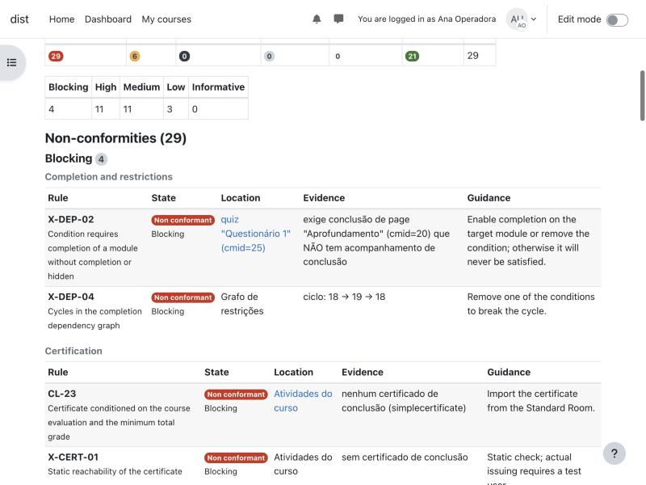

# Auditor MOOC — plugin Moodle `local_mooc_audit`

Plugin local do Moodle que **audita salas de cursos antes de uma nova oferta**: verifica 29 regras (datas, inscrição,
conclusão e restrições de acesso, livro de notas, questionários, certificado, recursos institucionais, arquivos e
imagens perdidos, conteúdo vazio ou oculto) e mostra um relatório com o local de cada problema, a evidência e o que
corrigir. Foi criado para a reoferta anual dos cursos MOOC do Cefor/Ifes, em que cada sala é reimportada e precisa ser
conferida de novo.

*English: the distributable plugin and its documentation for administrators are in
[plugin/local_mooc_audit/README.md](plugin/local_mooc_audit/README.md).*

## O que o plugin faz

| Funcionalidade | Onde fica no Moodle | Quem usa (papéis padrão) |
|---|---|---|
| **Auditoria técnica** de uma sala: executar, ler o último resultado, exportar JSON | Curso > Mais > *Auditoria técnica* | gerente, professor editor |
| **Correção assistida** de tentativas (CL-13) e encerramento (CL-14) de questionários, com prévia, simulação e trilha | link *Ver proposta de correção* no relatório | gerente, professor editor |
| **Histórico** e evolução entre auditorias (problemas novos, persistentes, resolvidos) | link *Histórico de auditorias* | gerente, professor editor |
| **Comparação entre ofertas** (oferta anterior × nova oferta) | Administração do site > Cursos > *Comparar ofertas* | gerente |
| **Painel de acompanhamento** e **auditoria em lote** em segundo plano | Administração do site > Cursos > *Acompanhamento das auditorias* | gerente |
| **Linha de comando** (auditoria, lote, comparação) | `local/mooc_audit/cli/` | administrador do servidor |
| **API por Web Services** (pedir auditoria, acompanhar, ler resultado); serviço vem desabilitado | Administração do site > Servidor > Serviços web | conta de integração |

A auditoria é **somente leitura**. Só a correção assistida escreve, e apenas depois de prévia e confirmação explícita.
Catálogo completo: [docs/guia-do-usuario.md](docs/guia-do-usuario.md).

## Situação

- **Versão 0.6.1, maturidade ALPHA.** Estágio: *plugin instalável para homologação* — instalado a partir do ZIP em
  Moodle 4.5 e 5.3 limpos, sem avisos com depuração de desenvolvedor, e usado de ponta a ponta por um perfil de professor
  editor ([relatório de prontidão](docs/prontidao-distribuicao/README.md)). Ainda não foi usado em produção nem
  homologado com usuários externos.
- **Política institucional embutida:** os padrões (datas 01/01–31/12, categoria "Inscrições Abertas", fórum "Espaço de
  interação", certificado `mod_simplecertificate`, bloco Progresso de Conclusão) são os do Cefor/Ifes. Em outro site,
  ajuste a política na administração do plugin antes de confiar nos resultados.

| | Testado | Observação |
|---|---|---|
| Moodle | 4.5 (4.5.15) e 5.3 (5.3+, build 20261030) | outras versões não testadas |
| PHP / banco | PHP 8.3, PostgreSQL 17 | MySQL/MariaDB ainda não testados |
| Plugins adicionais | nenhum obrigatório | lê `mod_simplecertificate`, `mod_game`, `mod_hvp` e `block_completion_progress` quando existem |
| Cron | necessário para lotes e pedidos pela API | a auditoria pela página roda na hora |

## Instalação rápida

1. **Obtenha o pacote** `local_mooc_audit-<versão>-<build>.zip`: ainda não há release publicada; gere-o com
   `tools/package-plugin.sh` (a partir de um commit, sem arquivos de desenvolvimento) ou baixe o artefato
   *local_mooc_audit-zip* da execução mais recente da CI. **Não** use o *Download ZIP* do GitHub: ele traz o projeto
   inteiro e o Moodle não o reconhece como plugin.
2. *Administração do site > Plugins > Instalar plugins* → enviar o ZIP → *Instalar plugin do arquivo ZIP* →
   *Continuar* → *Atualizar banco de dados do Moodle agora*.
3. Revise a política em *Administração do site > Plugins > Plugins locais > Auditoria MOOC*.

Instalação manual, atualização, desinstalação e permissões: [docs/instalacao.md](docs/instalacao.md).

## Primeira auditoria

Abra a sala, *Mais > Auditoria técnica*, clique em *Executar auditoria* e leia a *Situação geral* e as
*Inconformidades* por gravidade. Cada linha traz o local (com link para a configuração a mudar), a evidência e a
orientação. Corrija no Moodle e use *Executar novamente*. Passo a passo e interpretação dos estados:
[docs/guia-do-usuario.md](docs/guia-do-usuario.md).



## Limitações conhecidas

- Política e nomes canônicos de atividades específicos do Cefor/Ifes (decisão institucional 10 ainda pendente).
- Textos de evidência das regras gerados em português mesmo com a interface em inglês.
- Correção pelo plugin só para questionários; demais problemas apontam a página do Moodle onde se corrige.
- Não detecta problemas que só existem no arquivo de backup (`.mbz`) antes da restauração.

## Documentação

| Para | Documento |
|---|---|
| Administrador Moodle | [docs/instalacao.md](docs/instalacao.md) · [plugin/local_mooc_audit/README.md](plugin/local_mooc_audit/README.md) (inglês) · [API.md](plugin/local_mooc_audit/API.md) |
| Quem prepara a reoferta | [docs/guia-do-usuario.md](docs/guia-do-usuario.md) · [docs/catalogo-regras.md](docs/catalogo-regras.md) · [DECISOES-INSTITUCIONAIS-CHECKLIST.md](DECISOES-INSTITUCIONAIS-CHECKLIST.md) |
| Desenvolvedor / avaliador | [docs/desenvolvimento/README.md](docs/desenvolvimento/README.md) · [arquitetura do plugin](docs/desenvolvimento/arquitetura-plugin.md) · [CHANGES.md](plugin/local_mooc_audit/CHANGES.md) |
| Prontidão para distribuição | [docs/prontidao-distribuicao/README.md](docs/prontidao-distribuicao/README.md) |
| Processo (SDD) | [constituição](.specify/memory/constitution.md) · [specs/](specs/) · [docs/backlog.md](docs/backlog.md) |
| Histórico de engenharia | [docs/historico/](docs/historico/) · [docs/revisao-geral/](docs/revisao-geral/) · [plugin-results/](plugin-results/) · [poc/](poc/) |

## Organização do repositório

```
plugin/local_mooc_audit/   código do plugin (é o que vai para o ZIP, como mooc_audit/)
tools/package-plugin.sh    gera e confere o ZIP instalável
docs/                      instalação, guia do usuário, desenvolvimento, prontidão, revisões e histórico
specs/, .specify/          especificações e constituição do Spec-Driven Development (GitHub Spec Kit)
moodle-env/                receitas dos ambientes Moodle de laboratório (Docker)
plugin-results/, poc/      evidências por versão e protótipo Python que originou as regras
DECISOES-INSTITUCIONAIS-CHECKLIST.md   decisões institucionais que definem a política padrão
```

Os backups `.mbz` e a planilha do checklist têm conteúdo institucional e **não** são versionados.

## Licença

GNU GPL v3 ou posterior ([LICENSE](LICENSE)). Copyright 2026 Cefor/Ifes.
