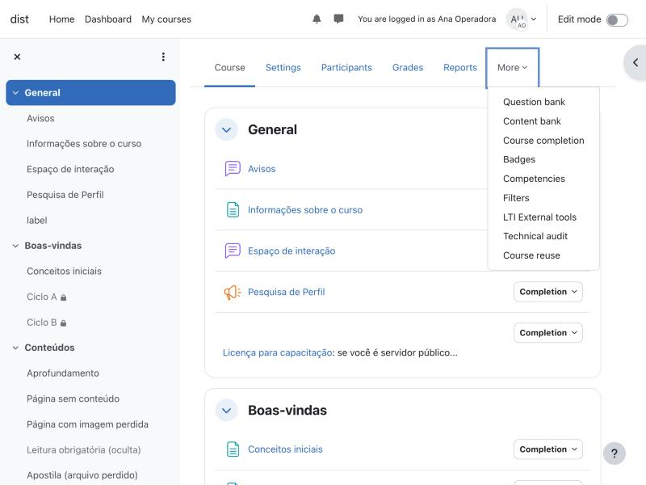
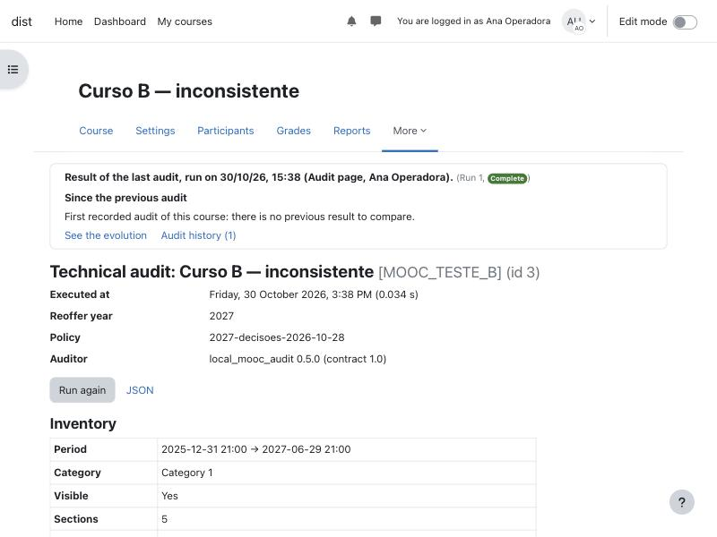
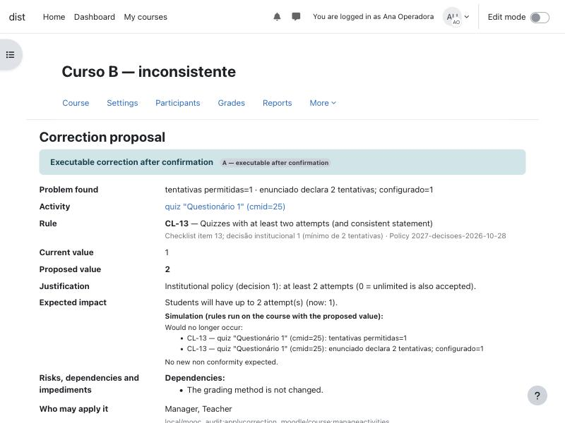
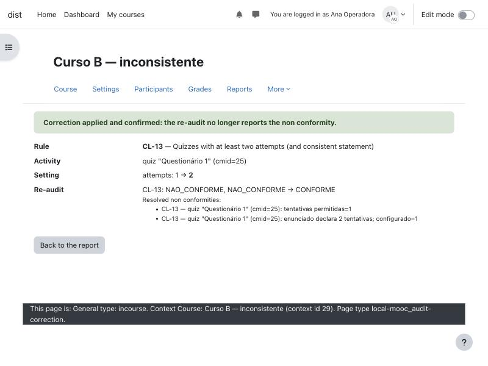
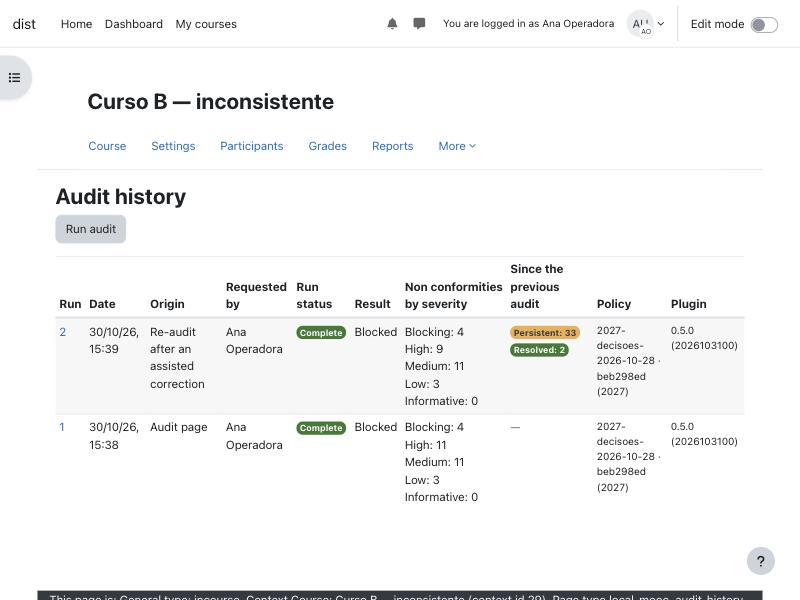
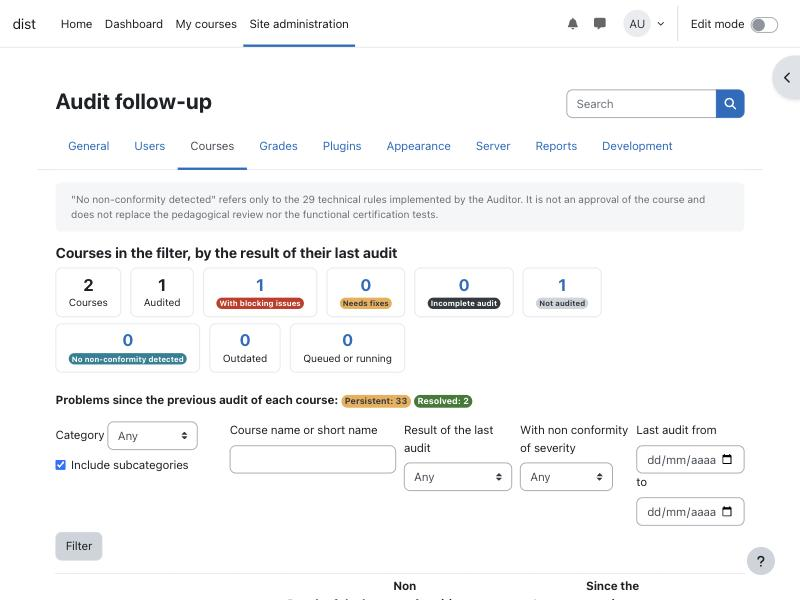

# Guia do usuário do Auditor MOOC (0.6.1)

Para quem prepara uma sala para nova oferta e para quem acompanha todas as salas. Os rótulos são os da interface em
português; entre parênteses, o equivalente em inglês. As telas abaixo foram capturadas num Moodle 4.5 limpo, em
inglês, com os cursos de teste A (referência) e B (com problemas conhecidos).

## Catálogo funcional

Reconstruído do código da versão 0.6.1 (páginas, capacidades e menus), não das especificações.

| Funcionalidade | Para quê | Quem (padrão) | Onde | Estado |
|---|---|---|---|---|
| Auditoria técnica | Verificar uma sala contra as 29 regras e ver o que corrigir | gerente, professor editor (`audit`) | Curso > Mais > *Auditoria técnica* (`index.php`) | Operacional |
| Exportação JSON | Guardar ou integrar o relatório (contrato 1.0, schema em `schema/`) | idem | link *JSON* no relatório; `cli/audit.php --json` | Operacional |
| Correção assistida | Corrigir tentativas (CL-13) e encerramento (CL-14) de questionários com prévia e confirmação | gerente, professor editor (`preparecorrection`, `applycorrection`) | *Ver proposta de correção* no relatório (`correction.php`) | Experimental; só questionários; CL-14 de outros tipos e CL-17 só orientam |
| Histórico e evolução | Ver auditorias anteriores e o que mudou entre elas | gerente, professor editor (`audit`) | *Histórico de auditorias* / *Ver a evolução* (`history.php`) | Operacional |
| Comparação entre ofertas | Comparar a sala da oferta anterior com a da nova oferta | gerente (`compare` + `audit` nas duas salas) | Administração do site > Cursos > *Comparar ofertas*; link no relatório | Experimental; correspondências manuais não são gravadas |
| Painel de acompanhamento | Ver a situação de todas as salas e filtrar | gerente (`viewdashboard`) | Administração do site > Cursos > *Acompanhamento das auditorias* (`dashboard.php`) | Operacional |
| Auditoria em lote | Auditar várias salas em segundo plano (categoria, lista, ano, seleção no painel) | gerente (`batchaudit`) | *Nova auditoria em lote* no painel (`batch.php`); `cli/batch.php` | Operacional; depende do cron |
| Linha de comando | Auditar, comparar e enfileirar lotes no servidor | administrador do servidor | `cli/audit.php`, `cli/compare.php`, `cli/batch.php` | Operacional |
| API por Web Services | Outro sistema pede auditorias e lê resultados | conta de integração (`api`, sem papel padrão) | serviço "Auditor MOOC" (desabilitado na instalação) | Experimental; ver [API.md](../plugin/local_mooc_audit/API.md) |
| Política institucional | Ajustar datas, nomes, blocos e limites verificados pelas regras | administrador do site | Administração do site > Plugins > Plugins locais > *Auditoria MOOC* | Operacional |
| Retenção do histórico | Apagar execuções antigas (mantém a última de cada sala) | automático | tarefa agendada diária `cleanup_history` | Operacional |

Nada do plugin aparece para professores não editores nem para estudantes.

## Primeira auditoria de uma sala

1. Abra a sala e escolha **Mais > Auditoria técnica** (*More > Technical audit*).

   

2. Na primeira vez, a página avisa que a sala ainda não foi auditada. Clique em **Executar auditoria** (*Run audit*).
   A execução leva menos de um segundo numa sala comum e fica registrada no histórico.
3. O topo mostra **quando** e **por quem** a auditoria foi feita, a comparação com a anterior e os links do histórico.
   Abaixo: ano da reoferta, versão da política, *Inventário* da sala e **Situação geral**.

   

4. Leia as **Inconformidades**, agrupadas por gravidade e por categoria. Cada linha tem:
   - **Regra**: identificador e título (lista completa no fim deste guia);
   - **Local**: atividade, seção ou configuração — é um link para a página do Moodle onde se corrige, quando existe;
   - **Evidência**: o que foi encontrado e, quando cabe, o *Esperado*;
   - **Orientação**: o que fazer.

   

5. Corrija no Moodle e clique em **Executar novamente** (*Run again*). A nova execução diz o que foi resolvido, o que
   persiste e o que é novo.

Ao voltar à página depois, ela mostra o **resultado da última auditoria** com a data, e avisa quando ele pode estar
desatualizado: a sala foi alterada depois, passou o prazo (7 dias), a política mudou ou o código das regras mudou.
Abrir a página **não** executa a auditoria.

## Como interpretar o resultado

### Situação geral

| Situação | Significa |
|---|---|
| **Bloqueada** (*Blocked*) | Há ao menos uma inconformidade bloqueante: a sala não deve ser ofertada assim (ex.: certificado inalcançável, ciclo de restrições). |
| **Requer correções** (*Needs fixes*) | Há inconformidades, nenhuma bloqueante. |
| **Sem inconformidades** (*No non-conformities*) | Nenhuma das 29 regras encontrou problema. **Não é aprovação da sala**: não substitui a revisão pedagógica nem o teste de certificação. |

### Estados de cada resultado

| Estado | O que fazer |
|---|---|
| **Não conforme** | Corrigir. |
| **Atenção** (aparece em *Alertas*) | Decidir: pode ser intencional (ex.: módulo oculto, encerramento diferente do término). |
| **Conforme** | Nada. As regras conformes ficam listadas no fim. |
| **Não se aplica** | Nada: a regra não vale para esta sala. |
| **Não verificável** | O plugin não teve como verificar (ex.: plugin ausente). Não é falha da sala; confira manualmente se importar. |
| **Erro na verificação** | A regra falhou ao executar; as demais não são afetadas. Relate o caso. |

Gravidades: **Bloqueante**, **Alta**, **Média**, **Baixa**, **Informativa**. A tabela *Resultados por estado*
conta resultados (uma regra pode gerar vários), não regras.

### O que o relatório não diz

- Não vê o arquivo `.mbz`: corrupção de backup só é detectável antes da restauração.
- Regras que dependem de nomes (fórum "Espaço de interação", pesquisas, certificado, blocos) seguem a política; num site
  com outros nomes, ajuste a política (ver [instalacao.md](instalacao.md)).
- Os textos de *Evidência* são gerados em português, mesmo com a interface em inglês.

## Correção assistida

Para CL-13 (tentativas) e CL-14 (encerramento de questionário), o relatório oferece **Ver proposta de correção**.



A proposta mostra o problema, a atividade, o valor atual e o proposto, a justificativa, uma **simulação** (as regras
rodadas com o valor proposto), riscos, dependências e **impedimentos** — por exemplo, o encerramento não é proposto
enquanto a data de término do curso estiver fora da política (CL-07). Abrir a proposta não grava nada.

**Confirmar correção** grava só aquela configuração, relê o valor, reaudita a sala, registra quem corrigiu e o valor
anterior, e só mostra sucesso se a reauditoria confirmar. Se a sala mudou entre a prévia e a confirmação, nada é
gravado (conflito). Não há desfazer automático: o valor anterior fica na trilha e pode ser restaurado na página da
atividade.



## Histórico e evolução

**Histórico de auditorias** lista cada execução (data, origem — página, lote, linha de comando, API, reauditoria após
correção —, solicitante, situação, contagem por gravidade, versão da política e do plugin). Cada execução abre o
relatório guardado e a evolução em relação à anterior: novas, persistentes, resolvidas, estado ou gravidade
alterados, não comparáveis (política ou regra mudou), recurso removido.



## Comparação entre ofertas (gerentes)

*Administração do site > Cursos > Comparar ofertas* (ou *Comparar com a oferta anterior* no relatório): escolha a sala
de **origem** (oferta anterior) e a de **destino** (nova oferta). O relatório mostra atividades preservadas, ausentes,
adicionais, modificadas e correspondências ambíguas, classifica as diferenças em esperadas, relevantes e informativas
e relaciona as duas auditorias (problema persistente, novo no destino, resolvido). A origem é auditada com a política
do ano dela. Nada é gravado.

## Painel e auditoria em lote (gerentes)

*Administração do site > Cursos > Acompanhamento das auditorias* mostra cada sala com a situação da última auditoria
(com bloqueantes, requer correções, sem inconformidades detectadas, auditoria incompleta, não auditada), se está
desatualizada, filtros por categoria, nome, situação, gravidade e data, e a evolução somada.



**Nova auditoria em lote** (ou *Auditar as salas selecionadas*) enfileira uma tarefa por sala, executada pelo cron em
nome de quem pediu, com as permissões conferidas de novo na hora. A página do lote mostra o andamento; falhas podem
ser reexecutadas. Limite padrão: 100 salas por lote. Sem cron, o lote fica "Na fila ou em execução".

## Linha de comando

```bash
php local/mooc_audit/cli/audit.php --courseid=3                 # texto
php local/mooc_audit/cli/audit.php --courseid=3 --json --out=/tmp/sala3.json
php local/mooc_audit/cli/audit.php --courseid=3 --record        # grava no histórico
php local/mooc_audit/cli/compare.php --source=8 --target=10
php local/mooc_audit/cli/batch.php --category=5 --subcats       # enfileira; --run executa no próprio processo
```

No Moodle 5.1 ou posterior os caminhos começam por `public/local/mooc_audit/cli/`.

## As 29 regras

As regras CL-* vêm do checklist institucional de reoferta (os números seguem a planilha; itens não automatizáveis não
têm regra); as X-* são verificações técnicas adicionais. Detalhes, fontes e risco de falso positivo:
[catalogo-regras.md](catalogo-regras.md).

| Regra | Verifica |
|---|---|
| CL-04 | Sumário contém botões institucionais |
| CL-05 | Categoria do curso = categoria de inscrições abertas |
| CL-06 | Data de início correta (01/01 do ano da reoferta) |
| CL-07 | Data de término correta (31/12 do ano da reoferta) |
| CL-08 | Autoinscrição habilitada com período correto |
| CL-09 | Fórum institucional "Espaço de interação" presente e sem conclusão |
| CL-11 | Pesquisa de Perfil presente e exigida pelo certificado |
| CL-12 | Livro de notas: soma 100, agregação Natural, sem excluir vazias |
| CL-13 | Questionários com ao menos duas tentativas (e enunciado coerente) |
| CL-14 | Atividades avaliativas com data de encerramento |
| CL-16 | Avaliação do curso restrita à conclusão de todas as atividades com nota |
| CL-17 | Conclusão automática com critério adequado ao tipo |
| CL-18 | Glossário: proibido se colaborativo; vazio se fonte de jogos |
| CL-19 | Rótulos sem conclusão de atividade |
| CL-20 | Seções: ocultas invisíveis, sem seções vazias ou com nome genérico |
| CL-21 | Blocos padrão presentes na página do curso |
| CL-22 | Licença para capacitação configurada |
| CL-23 | Certificado condicionado à Avaliação do curso e à nota mínima no total |
| X-AV-01 | Enunciado × configuração (pontos) |
| X-CERT-01 | Alcançabilidade estática do certificado |
| X-CONT-01 | Recursos vazios (página/rótulo sem conteúdo, questionário sem questões, arquivo sem arquivo) |
| X-CONT-04 | Referências @@PLUGINFILE@@ sem arquivo correspondente |
| X-DEP-01 | Condições de acesso apontando para módulos inexistentes |
| X-DEP-02 | Condição exige conclusão de módulo sem conclusão ou oculto |
| X-DEP-03 | Condições de nota apontando para itens inexistentes |
| X-DEP-04 | Ciclos no grafo de dependências de conclusão |
| X-INT-02 | Arquivos registrados sem conteúdo no armazenamento do Moodle |
| X-INT-03 | Plugins usados pelo curso instalados no site |
| X-STR-01 | Módulos ocultos, invisíveis ao usuário ou com nome vazio |
