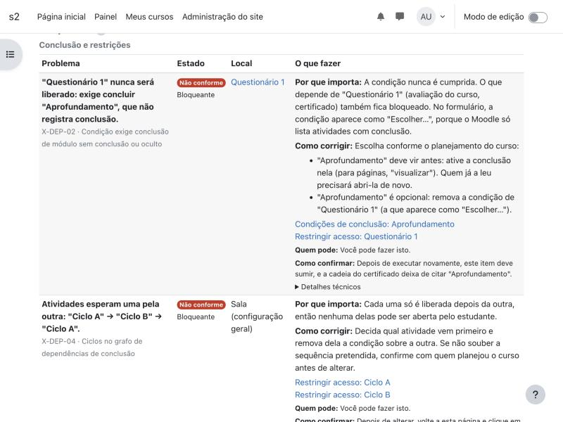

# Resultados — Spec 006, fase 1 (textos e links)

**Versão:** Auditor 0.7.0 (2026103102). **Ramo:** `claude/spec-006-implementacao`. **Data:** 2026-10-30.

## O que mudou para quem usa

Cada linha de problema do relatório passou a dizer, no idioma de quem vê e com os nomes atuais das atividades:

- **o problema** em uma frase (o código da regra fica discreto, abaixo);
- **por que importa**;
- **como corrigir**, com as alternativas quando a escolha é pedagógica (X‑DEP‑02, alvo oculto);
- **ações** que abrem a seção certa do formulário do Moodle (`showonly`), para as duas pontas de uma dependência e
  para cada atividade de um ciclo, só quando a atividade existe e quem vê pode usar a tela;
- **quem pode** e **como confirmar**;
- **notas de ordem** (lista fechada): condição de acesso inválida antes de outra correção na mesma atividade; datas
  do curso antes da inscrição e do encerramento; soma das notas antes da nota mínima do certificado;
- **aviso de plugin ausente** no topo, quando o site não tem um plugin de que a política depende;
- **detalhes técnicos** num `
` nativo: regra, verificação, evidência, encontrado, exigido, orientação gravada
  e chave da ocorrência.

Linhas sem mensagem (execuções muito antigas) continuam com o texto gravado.

## O que não mudou

Regras, estados, gravidades, ids, chaves de ocorrência, impressão digital do código das regras e contrato JSON 1.0.
Nenhum arquivo de `classes/local/rule/`, `classes/engine.php` ou `classes/snapshot.php` foi alterado.

## Cobertura

- 81 variantes de mensagem (29 regras), cada uma com problema, por que importa e como corrigir em `en` e `pt_br`
  (`presentation_catalog_test`).
- Toda verificação declarada pelas regras está no catálogo; todo resultado não conforme, de atenção ou não verificável
  dos Cursos A e B tem mensagem.

## Verificação

| Verificação | Resultado |
|---|---|
| PHPUnit completo (Moodle 4.5.15, laboratório s2) | **258 testes, 7.652 asserções, todos verdes** — inclui `characterization_test` (Cursos A/B sem regravar) e os 14 testes novos (`presentation_catalog_test`, `presentation_finding_test`) |
| Behat `@local_mooc_audit` | **15 cenários, 244 passos, todos verdes** — inclui `report_fix.feature`: professor editor segue "Condições de conclusão: Aprofundamento", o formulário abre só nessa seção, ativa a conclusão, executa de novo e o problema some; professor sem edição vê o texto e "Professor editor da sala", sem ações; axe sem violações |
| PHPCS `moodle` | limpo nos arquivos novos e alterados |
| Moodle 5.3 (site dist53, só inglês, sem os três plugins de terceiros) | textos em inglês; aviso de plugins ausentes no topo; CL‑23, X‑CERT‑01 e CL‑21 indicam o administrador; CL‑18 deixa de mandar remover o glossário; CL‑20 cita o rótulo do 5.3 ("Hide completely"); rotas `showonly` corretas |
| Relatório real do Curso B (4.5, `pt_br`) | 30 de 30 linhas com mensagem; nenhuma linha principal com `cmid=`, `status=` ou JSON |

**Achado do teste Behat:** a página do Curso B de referência não termina de renderizar em 10 s no Behat (o índice do
curso com 24 atividades renderiza templates por AJAX sem cache); no navegador real não há erro. O cenário da jornada
usa uma sala com só a dependência do caso A, montada por um passo do plugin.

**Ajuste feito durante a fase:** os textos do CL‑13 e do CL‑14 citavam o botão "Ver proposta de correção", que só
aparece para quem pode preparar correções; passaram a dizer "se esta linha oferecer a correção assistida".

## Captura

## O que fica para as próximas fases

- Fase 2: resumo no topo, "Comece por aqui", visões por atividade e por prioridade, causas agrupadas e contadas
  (FR‑038), verificações manuais (FR‑040), detalhes da auditoria recolhidos, celular.
- Fase 3: `params` no contrato para dizer "encontrado × exigido" em frase; prévia e resultado da correção sem códigos.
- Fase 4 (decisão do Cefor): X‑INT‑03 com plugins exigidos, CL‑17 em rótulos e fórum institucional, CL‑18 sem afirmar
  colaboração, alvo oculto igual no X‑DEP‑02 e no X‑CERT‑01.
- Linha de base com pessoas no site congelado em 0.6.1 e avaliação final com a nova interface (FR‑029, FR‑030).
